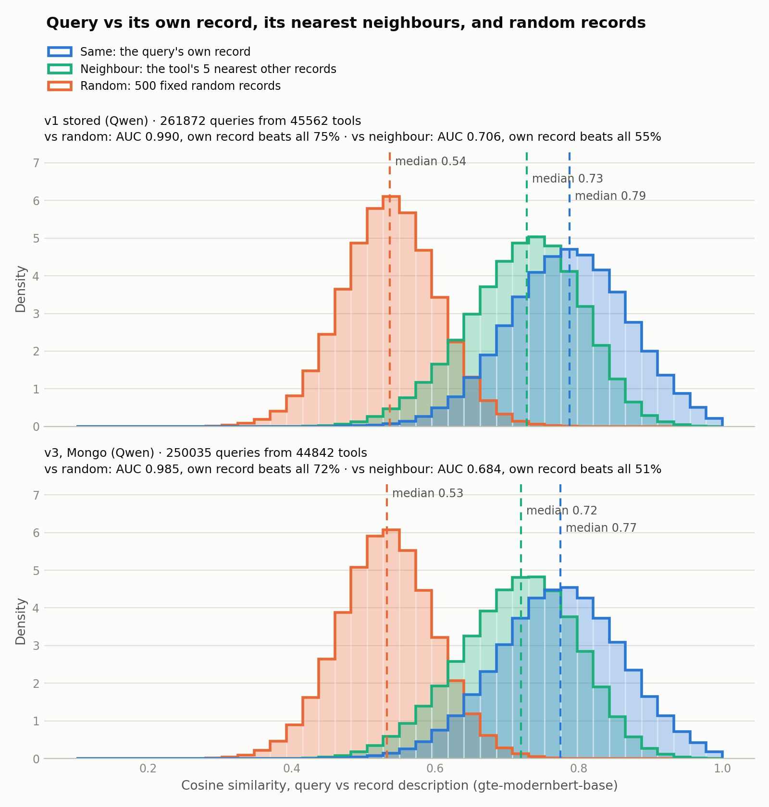
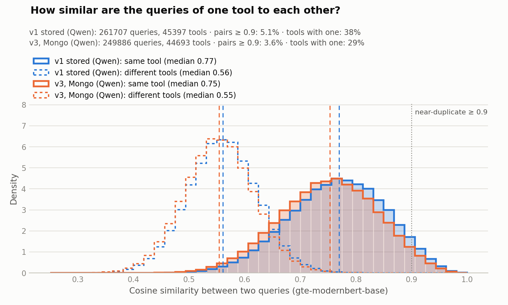

# Semantic search for the Software Observatory

> This repository contains the design and evaluation of a semantic search for the [Software Observatory](https://observatory.openebench.bsc.es): a search that finds research software from a description of the task, not only from the tool's name.

## Overview

**Goal.** The Observatory's search matches keywords. It finds a tool when you know its name, but a researcher who describes what they need ("remove haplotigs from a diploid assembly") rarely sees the right tool. This repo designs a search that understands the task, and measures whether it beats the keyword search.

**How.**

1. **Synthetic queries.** An LLM wrote up to six search queries per tool from its
record and, where there is one, its GitHub README (about 250k queries for 50k
   tools), so a user's query can be matched against how people would ask for the
   tool. Prompts were compared
   for grounding and diversity ([Synthetic queries](#synthetic-queries)).
1. **Index.** The pipeline ([research-software-etl](https://github.com/inab/research-software-etl))
   stores descriptions, synthetic queries and names in Qdrant, as dense vectors
   (gte-modernbert-base) and BM25.
2. **Four retrievers**, each with a different strength: description meaning,
   description keywords, tool names, and synthetic queries.
3. **Hybrid.** Their rankings are fused with Reciprocal Rank Fusion, plus a name
   rule: when the query is a tool's name, that tool's vote counts 3×; when it is
   not, the names retriever is left out.
4. **Evaluation.** 1,416 test queries for 300 random tools (596 name queries and
   820 task descriptions), scored by MRR@10 against every retriever, the hybrid and
   the current Observatory search.

**Result.** The hybrid beats the current keyword search on every kind of query:

| MRR@10 (1 = right tool always first) | All | Name queries | Task queries |
|---|---|---|---|
| Current Observatory search (keyword) | 0.264 | 0.585 | 0.031 |
| **Semantic hybrid** | **0.628** | **0.790** | **0.511** |
| Improvement | 2.4× | +35% | 16× |

Overall, the hybrid is also better than any of its retrievers alone, because each
one has a blind spot the others cover. 

Details, limits and how to reproduce: [Retrieval evaluation](#retrieval-evaluation). 
The full reasoning behind each choice is in the [methodology doc](https://claude.ai/artifact/Lg2MjkavtvYKStL8ZUFBnT).

## Contents

- [Install](#install) and [Layout](#layout)
- [Retrieval evaluation](#retrieval-evaluation): the retrievers, the hybrid, the test queries and the results
- [Synthetic queries](#synthetic-queries): how they were generated and how they compare with the first prompt ([full details](docs/synthetic_queries.md))
- [Datasets](#datasets): which data files are in git
- [Qdrant index](docs/qdrant.md): accessing the `tool_search` vector index and what is in it

The pipeline that builds the data lives in research-software-etl; this repo samples,
compares, scores and plots. **Split rule:** anything a pipeline stage or `rsetl`
command runs stays in the pipeline.

## Install

The prompt, the context built from a tool and the query filters (`parse_queries`,
`build_request`, `clean_readme`, `vocabulary`) are imported from the pipeline,
never copied, so an evaluation measures exactly what the pipeline does.

```bash
pip install -e ../research-software-etl   # local checkout (development)
pip install -e .
# or, from git (pin the ref to a commit or tag first):
pip install -e ".[pipeline]"
```

Only the experiment script and `snapshot_queries` need credentials: MongoDB, Gepeto and GitHub. Copy
`.env.example` to `.env` and fill it in. The analyses only read files under `data/`.

The pipeline installs generic top-level packages (`application`, `domain`,
`infrastructure`, `adapters`). Don't create modules with those names here.

The embedding model is `Alibaba-NLP/gte-modernbert-base`, the same one the pipeline's
similarity stage uses. Once it's cached, `HF_HUB_OFFLINE=1` avoids reaching huggingface.co.

## Layout

```
src/search_eval/
├── common.py                         # paths, loading, record text, embeddings, neighbours, provenance, plot style
├── snapshot_queries.py               # copy one prompt version's queries from MongoDB (semantic_search) into data/
├── eval_queries.py                   # build the retrieval test queries (sample, names, tasks, finish)
├── retrieval/
│   ├── index.py                      # Qdrant client, encoder, Hit
│   ├── dense_description.py          # dense vectors of tool descriptions
│   ├── bm25_description.py           # BM25 on tool descriptions
│   ├── bm25_names.py                 # BM25 on names and labels (tool_search_exp_names), name matching
│   ├── dense_queries.py              # dense vectors of the synthetic queries, grouped by tool
│   ├── hybrid.py                     # RRF fusion of the four, with the name rule
│   └── observatory_api.py            # the current Observatory search, as a baseline
├── experiments/
│   └── readme_queries.py             # generate a query set online (Gepeto) for the 500-tool sample
└── analysis/
    ├── retriever_comparison.py       # score every retriever, the hybrids and the API on the test queries
    ├── query_source_similarity.py    # one query set, random sample of the whole corpus: query vs own record
    ├── query_versions_similarity.py  # several query sets on the 500-tool sample: query vs own record
    └── query_diversity.py            # several query sets on the 500-tool sample: queries of a tool vs each other
data/                                 # gitignored, see Datasets
```

Run any module with `python -m search_eval.<package>.<module>`, and add `--help` for its options.

## Retrieval evaluation

The full methodology, with the reasons for each choice, is in the
[methodology doc](https://claude.ai/artifact/Lg2MjkavtvYKStL8ZUFBnT). This is the summary.

### What is searched

The `tool_search` collection in Qdrant ([docs/qdrant.md](docs/qdrant.md)) holds, for
50,314 tools, a description point (dense vector and BM25) and 250,817 synthetic
query points (dense). `tool_search_exp_names` holds one point per tool with BM25 on
its name and labels (built by `rsetl search-index --names`). The dense model is
gte-modernbert-base.

### The retrievers and the hybrid

| Retriever | Searches | Catches |
|---|---|---|
| `dense_description` | description vectors | paraphrases of what a tool does |
| `bm25_description` | description words (BM25) | rare terms, formats, names in descriptions |
| `bm25_names` | names and labels (BM25, no stemming or stopwords) | lookups by name |
| `dense_queries` | synthetic query vectors, best per tool | how users phrase a task |

`hybrid` fuses the four with Reciprocal Rank Fusion: each takes its top 100 and a
tool scores Σ w / (60 + rank). Ranks only, so cosine and BM25 scores are never
compared. On top of that, the **name rule**:

- a `bm25_names` hit whose name *is* the query (exact after normalising, or near
  with ratio ≥ 0.9 when nothing is exact) gets weight 3, so "samtools" returns
  samtools before samtools_stats;
- when no hit matches, `bm25_names` gets weight 0: for a task query it only matches
  ordinary words. This is the default (`hybrid_4_adaptive` below).

```bash
python -m search_eval.retrieval.hybrid --show-ranks "remove haplotigs from a diploid assembly"
```

### Test queries

There were no real user queries, so `eval_queries` builds them for 300 tools sampled
uniformly from the index (seed 20261112), into `data/eval_queries/`:

- **596 name queries**, by rule: the exact name (300), a one-edit typo for names of
  6+ letters (236), a variant with separators as spaces and lowercase (60).
- **820 task queries** for 275 tools, written by glm5.3-fp8 from the tool's record:
  a keyword search, a short description and a question, never the name. A different
  model and prompt from the indexed synthetic queries.
- **Leakage check**: a task query's cosine to its own tool's closest indexed query
  has median 0.845 (0.741 for other tools); 3% are near-copies (≥ 0.95) and are also
  scored apart.

A query is answered if its tool, or a record with the same normalised name, is in
the top 10 (`--strict`: the tool only; it changes MRR by ≤ 0.011).

```bash
python -m search_eval.eval_queries sample --n 300 --seed 20261112
python -m search_eval.eval_queries names
python -m search_eval.eval_queries tasks
python -m search_eval.eval_queries finish
python -m search_eval.analysis.retriever_comparison            # and --strict
```

`retriever_comparison` caches each retriever's hits in `data/eval_queries/runs.jsonl`
and writes `data/eval/retriever_comparison_{lenient,strict}.{csv,json,png}`
(Recall@1/5/10 and MRR@10 per query type).

### Results, 2026-11-12

MRR@10 (1 = the right tool always first):

| System | All | Name queries | Task queries |
|---|---|---|---|
| **hybrid_4_adaptive (default)** | **0.628** | 0.790 | 0.511 |
| hybrid_4_boost (names never dropped) | 0.603 | 0.792 | 0.465 |
| hybrid_4 (no name rule) | 0.563 | 0.696 | 0.465 |
| hybrid_3 (no `bm25_names`) | 0.526 | 0.548 | 0.510 |
| bm25_description | 0.511 | 0.676 | 0.391 |
| dense_description | 0.424 | 0.525 | 0.350 |
| dense_queries | 0.355 | 0.126 | 0.521 |
| bm25_names | 0.330 | 0.728 | 0.041 |
| observatory_api (current search) | 0.264 | 0.585 | 0.031 |

Conclusions:

- **Each retriever has a blind spot.** `dense_queries` is best on tasks but can't find
  names (the synthetic queries never contain them); `bm25_names` is the reverse.
- **The hybrid keeps both strengths.** With the name rule it is best on names and
  within 0.01 of the best single retriever on tasks.
- **Both halves of the name rule matter.** Boosting matches lifts name queries
  (0.696 → 0.792); dropping the names list when nothing matches lifts task queries
  (0.465 → 0.511) at no cost on names.
- **Against the current search**: 2.4× overall, 35% better on names and 16× on task
  queries (0.031 → 0.511).

Limits: the queries are synthetic (LLM- and rule-made), and only the tool and its
same-name records count as right, so equally good alternatives count as misses.
Both affect every system alike; the next step is to re-test on real Observatory
search queries.

## Synthetic queries

Qwen3.6-27B wrote up to six search queries per tool on MareNostrum 5, using prompt v2
revised. The prompt gives the model the tool's record (description and EDAM terms)
and, for the 8k tools that have one, a cleaned excerpt of their GitHub README. It
also asks for queries of 4-10 words the way a researcher would type them, without the
tool's name. The result is 250k queries for 45k tools; the other 5k tools had too
little information. Compared with the earlier record-only prompt (v1, same model,
whole corpus), the queries stay just as tied to their own tool: AUC against random
records is 0.985 vs 0.990. They are also more varied: 29% of tools have two
near-duplicate queries (cosine ≥ 0.9), down from 38%. They sit slightly further
from the description (median cosine 0.77 vs 0.79). In an earlier run, that drift
came only from tools with a README, and when we read the queries by hand it shows up as real
README details (file formats, input types), not invented capabilities. The
datasets, prompt versions, the GLM experiments on a 500-tool sample, the analyses
and the full results are in
[docs/synthetic_queries.md](docs/synthetic_queries.md).

| Each query vs its own record, its 5 nearest neighbours and random records | Similarity between two queries of the same tool |
|---|---|
|  |  |

In both plots, "v3, Mongo (Qwen)" is the prompt v2 revised set as indexed (`data/v3`, a MongoDB snapshot from 2026-10-27).

## Datasets

All under `data/`.

**Data files.** Most of `data/` is too big for git and is ignored. Only the small
reference files are tracked (about 1.4 MB; the exceptions are in `.gitignore`):

- every `dataset.json` and `sample.json`, plus `results.dataset.json`;
- the retrieval test queries: `eval_queries/{queries,name_queries,task_queries}.jsonl`;
- the analysis summaries: `eval/*.json`, `eval/*.png`, `eval/retriever_comparison_*.csv`.

The query sets, `query_requests.jsonl` and `eval_queries/runs.jsonl` are not in
git. The embedding cache and the large per-query CSVs are rebuilt by running the
analyses again.
