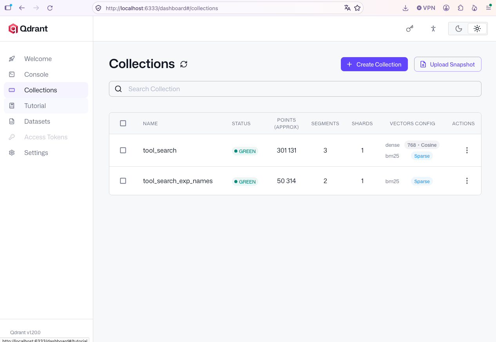
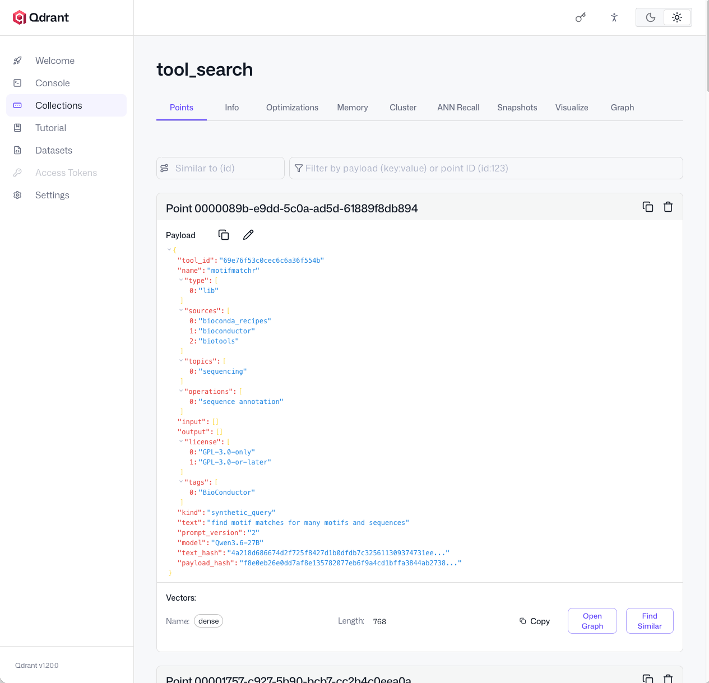
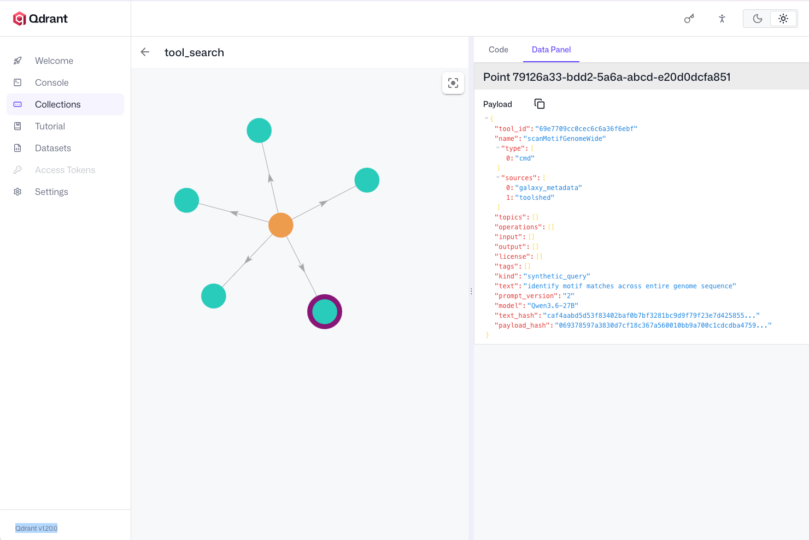

# Qdrant: the `tool_search` vector index

The semantic-search index lives in a Qdrant collection, `tool_search`. It is built
by the pipeline (`rsetl search-index` in research-software-etl) from the `tools` and
`semantic_search` MongoDB collections. This repo **reads** it. Don't write to it from
here (see [Experiments](#experiments-own-collections)).

## Access

Qdrant (v1.20) runs on the observatory server and listens only there, on port 6333.
To reach it, open an SSH tunnel from your machine and leave it running:

```bash
ssh -N -L 6333:localhost:6333 <user>@<observatory-server>
```

`-N` opens the tunnel without a remote shell; stop it with Ctrl-C. While it is up,
Qdrant is on your local port 6333:

- REST API: `http://localhost:6333`
- Dashboard: `http://localhost:6333/dashboard`

Every request needs the API key. Put it in `.env`, with the same variable names the
pipeline uses:

```bash
QDRANT_URL=http://localhost:6333
QDRANT_API_KEY=...            # ask the maintainer; never commit it
```

```python
import os
from qdrant_client import QdrantClient

client = QdrantClient(
    url=os.getenv("QDRANT_URL", "http://localhost:6333"),
    api_key=os.getenv("QDRANT_API_KEY"),
    cloud_inference=True,  # needed to send text for BM25 (see below)
    timeout=60,  # the 5 s default can trip on the first query after a while idle
)
```

Two things to watch for:

- **Always pass `url`.** With an API key and `url=None`, `qdrant-client` defaults to
  HTTPS. The tunnel speaks plain HTTP, so that fails with
  `SSL: WRONG_VERSION_NUMBER`.
- The client warns `Api key is used with an insecure connection`. That's expected
  over the local tunnel.

If requests start failing with `Connection refused` or `Connection reset by peer`,
the tunnel is down.

## Exploring it in the dashboard

The dashboard is the quickest way to look at the data without writing code. Open
`http://localhost:6333/dashboard` with the tunnel up.

**The dashboard needs the API key** (the same `QDRANT_API_KEY` as in `.env`). Without
it, it loads but shows no collections and every request fails as unauthorised. Enter
the key when prompted, or with the key icon at the top right. The browser remembers
it, so you only do this once per browser.

**Collections** lists both collections with their point counts and vectors:
`tool_search` (`dense` 768-d cosine + `bm25` sparse) and `tool_search_exp_names`
(`bm25` only).



Click a collection to browse its points. Each one shows its payload and vectors.
The filter box takes `key:value` (e.g. `kind:description`, `tool_id:69e76f53c0cec6c6a36fc883`,
`topics:sequencing`), and **Find Similar** lists the points nearest to one, which is a
fast way to see which queries and tools sit close together. The other tabs (**Info**,
**Visualize**, **Graph**) show the collection config, a 2-D projection and a
neighbour graph.



**Graph** (or **Open Graph** on a point) draws a point and its nearest neighbours by
the `dense` vector. Click a neighbour to see its payload on the right, and to expand
its own neighbours. It is a quick way to see which tools' queries and descriptions
end up close together.



**Console** sends REST requests straight to the API, e.g.

```
GET collections/tool_search
POST collections/tool_search/points/count
{"exact": true, "filter": {"must": [{"key": "kind", "match": {"value": "description"}}]}}
```

The dashboard can also edit and delete points and collections (the pencil and bin
icons, **Create Collection**). Don't use those on `tool_search`; it is read-only from
here.

## What is in it

Snapshot of 2026-11-04 (prompt version 2 queries, `Qwen3.6-27B`); the payload was
extended afterwards with the filter fields below (point counts checked unchanged on
2026-11-18, 301,131 in total):

| `kind` | Points | One per | Vectors |
|---|---|---|---|
| `description` | 50,314 | tool (every tool in `toolsDev`) | `dense` + `bm25` |
| `synthetic_query` | 250,817 | stored synthetic query | `dense` only |

Tools whose queries are `insufficient` in `semantic_search` Mongo collection (about 5k) have a
description point but no query points.

### Vectors

- **`dense`**: 768 dimensions, cosine, L2-normalised, from
  `Alibaba-NLP/gte-modernbert-base` (the same model as `common.DEFAULT_MODEL` and the
  similarity stage). No query/document prefix is used. Encode search queries the same
  way: `model.encode(q, normalize_embeddings=True)`. Inputs are capped at 512 tokens.
- **`bm25`**: sparse, IDF modifier, **computed by Qdrant itself** (`qdrant/bm25`,
  English stemming and stopwords). Send text, not tokens:
  `models.Document(text=q, model="qdrant/bm25")`. Only description points have it.

### What text each point was embedded from

**Description point, `dense`:**

```
<preferred_label or name>: <longest distinct description, max 2000 chars>
Topics: <EDAM topic terms>.
Operations: <EDAM operation terms>.
Input: <EDAM input format terms>.
Output: <EDAM output format terms>.
```

If there is no description, the `help` documentation text is used instead. Empty
lines are left out. Caveat: 2,000 characters is close to the 512-token cap, so for
the longest descriptions the EDAM lines at the end may be truncated away.

**Description point, `bm25`:** every name the tool goes by (preferred label, name,
labels, other names), every distinct description, then the same EDAM lines.

**Query point, `dense`:** the query text alone.

The exact code is `description_dense_text`, `description_sparse_text` and
`tool_points` in the pipeline's
`application/services/semantic_search/search_index.py`. Import them rather than
copying them, as with the other pipeline functions.

### Payload

| Field | On | Meaning |
|---|---|---|
| `tool_id` | all | the tool's `_id` in `toolsDev`, as a string (`ObjectId(tool_id)` to join with MongoDB) |
| `kind` | all | `description` or `synthetic_query` |
| `name` | all | display name (`preferred_label`, else `name`) |
| `type` | all | the tool's `data.type` list, e.g. `["cmd"]`, `["web", "lib"]` |
| `sources` | all | registries the tool was merged from (`data.source`), e.g. `["bioconda_recipes", "biotools", "github"]` |
| `topics` | all | EDAM topic terms (`data.topics`), as `term_key`s, e.g. `["cell biology", "imaging"]` |
| `operations` | all | EDAM operation terms (`data.operations`), as `term_key`s |
| `input` | all | EDAM input format terms (`data.input`), as `term_key`s |
| `output` | all | EDAM output format terms (`data.output`), as `term_key`s |
| `license` | all | license names (`data.license[].name`), e.g. `["GPL-3.0-only"]` |
| `tags` | all | the tool's `data.tags` |
| `text` | all | the dense text above (for a query point, the query) |
| `prompt_version` | queries | prompt that wrote the query (`"2"`) |
| `model` | queries | LLM that wrote the query |
| `text_hash`, `payload_hash` | all | used by the pipeline for incremental updates; ignore them |

The list fields are sorted, deduplicated and `[]` when the tool has none. EDAM terms
are stored as `term_key(term)` (trimmed, leading `"` dropped, lowercased; in the
pipeline's `search_index.py`), so filter with lowercased terms such as
`"sequence assembly"`, not EDAM labels or URIs. The observatory API normalises its
filter values the same way.

Keyword payload indexes exist on `tool_id`, `kind`, `prompt_version` and every filter
field (`type`, `sources`, `topics`, `operations`, `input`, `output`, `license`,
`tags`; `FILTER_FIELDS` in the pipeline), so filtering and grouping on those are fast.

Point ids are UUIDs derived from the tool id and the text. Don't key anything on
them; use `tool_id`.

## Querying

A tool has several points, so group the results by `tool_id`. Hybrid search
(dense over both kinds, plus BM25 over descriptions, fused with RRF):

```python
from qdrant_client import models
from sentence_transformers import SentenceTransformer

model = SentenceTransformer("Alibaba-NLP/gte-modernbert-base")
q = "remove haplotigs from a diploid assembly"
vector = model.encode(q, normalize_embeddings=True).tolist()

result = client.query_points_groups(
    "tool_search",
    prefetch=[
        models.Prefetch(query=vector, using="dense", limit=200),
        models.Prefetch(
            query=models.Document(text=q, model="qdrant/bm25"),
            using="bm25",
            limit=200,
        ),
    ],
    query=models.FusionQuery(fusion=models.Fusion.RRF),
    group_by="tool_id",
    group_size=3,  # best-matching points per tool, to see which text matched
    limit=10,
    with_payload=["name", "kind", "text"],
)
for group in result.groups:
    print(group.id, [(h.payload["kind"], round(h.score, 3)) for h in group.hits])
```

Variants, for comparing retrieval strategies:

- **Queries only / descriptions only:** add
  `filter=models.Filter(must=[models.FieldCondition(key="kind", match=models.MatchValue(value="synthetic_query"))])`
  to the dense `Prefetch` (or to `query_points_groups` itself, without prefetch).
- **By tool type or registry:** `FieldCondition(key="type", match=models.MatchAny(any=["cmd", "lib"]))`,
  and the same with `key="sources"`.
- **By EDAM term, license or tag:** the same `MatchAny` on `topics`, `operations`,
  `input`, `output`, `license` or `tags`, e.g.
  `FieldCondition(key="topics", match=models.MatchAny(any=["genomics"]))`. A filter
  passed to `query_points_groups` itself also applies to every prefetch.
- **BM25 alone:** `client.query_points_groups("tool_search", query=models.Document(text=q, model="qdrant/bm25"), using="bm25", group_by="tool_id", limit=10)`.

## Keeping it current

The pipeline updates the collection with `rsetl search-index`, which is incremental:
it re-embeds only changed text, rewrites changed payloads and deletes points of
retired tools and replaced queries. It is not yet a stage of `rsetl run`, so the
index is as fresh as its last manual run. Results can change between runs; record
`client.count("tool_search")` and the date alongside any evaluation result.

## Experiments: own collections

To try a different embedding model, a different description text, or v1 queries,
build a **separate** collection (e.g. `tool_search_exp_<name>`) rather than
changing `tool_search`, which is the one the search uses. Reuse the pipeline's
point builders where possible, so the only difference is the thing being tested.
Delete experiment collections when done.

One exists already: **`tool_search_exp_names`**, one BM25-only point per tool
(`kind: "name"`) over the tool's name and labels, with the same payload as above
(`text` is the names). Built by the pipeline's `build_name_index`; it has no dense
vector.
